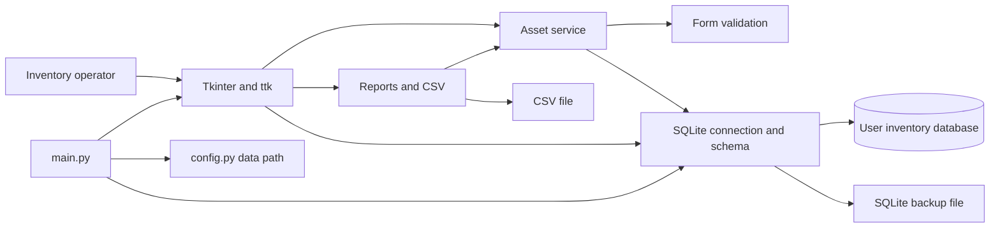
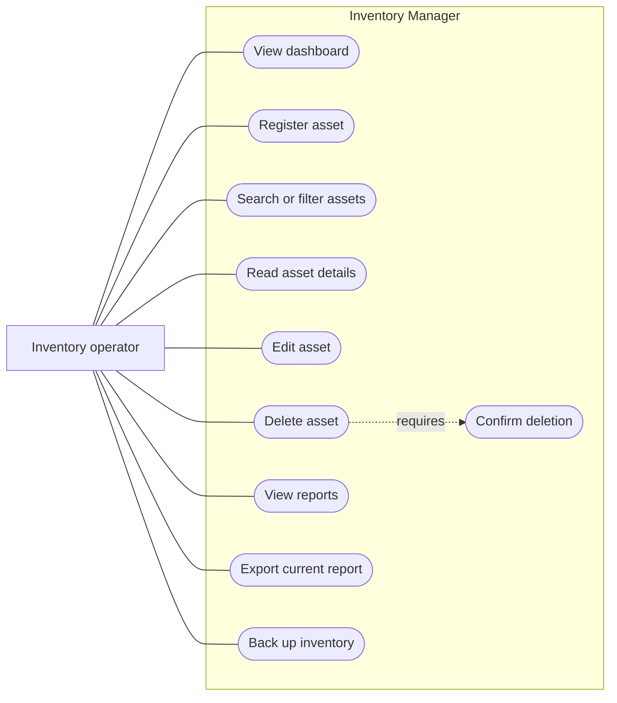
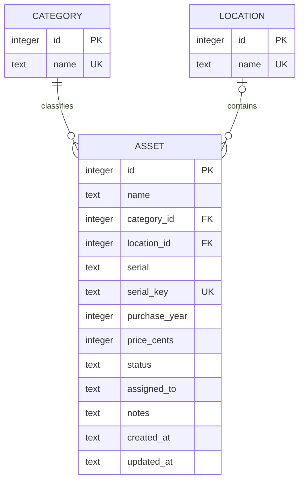
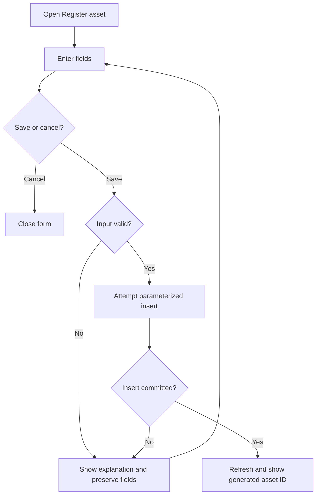
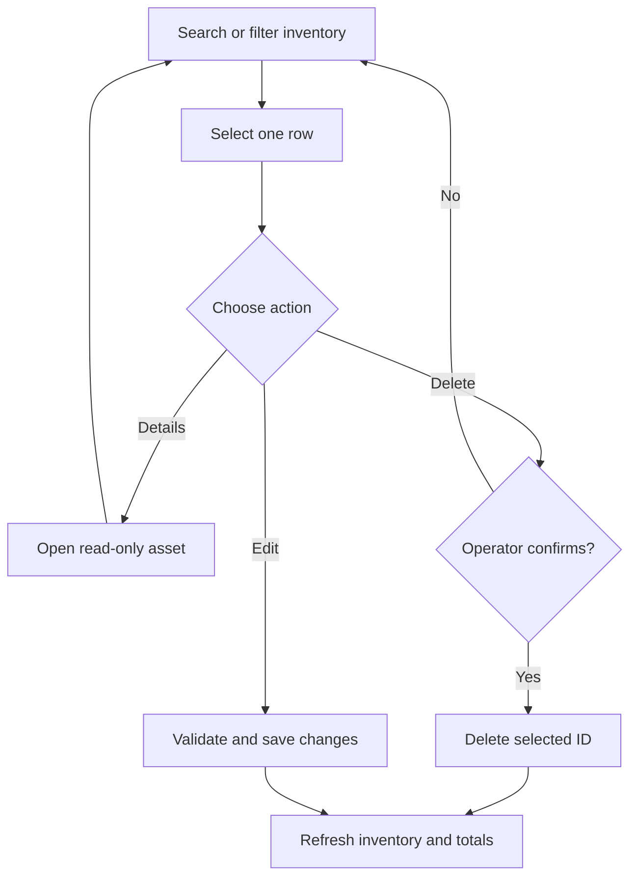
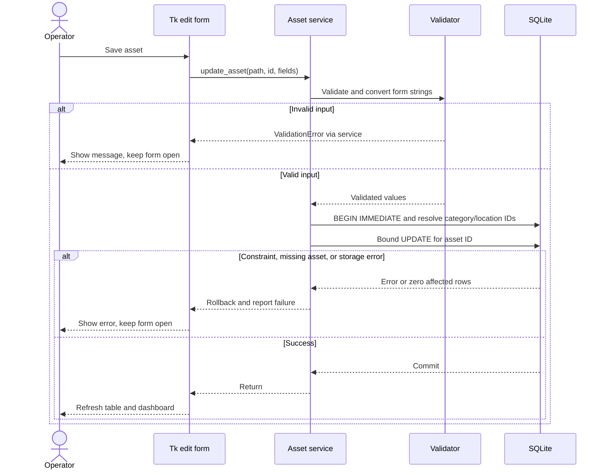
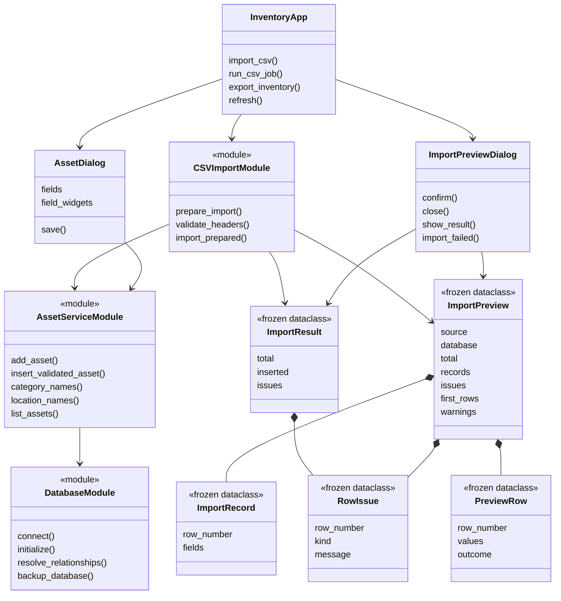
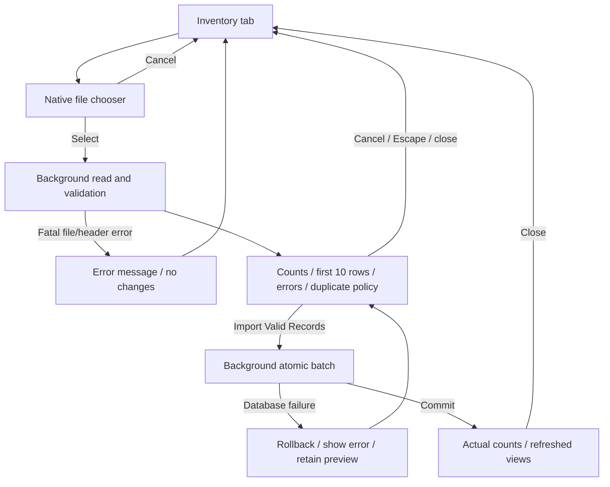

# Architecture and editable diagrams

Tk callbacks own interaction, selection and status messages. They send plain
form strings and asset IDs to the service. The service invokes validation,
binds values, and returns SQLite rows. Reports turn one inventory snapshot
into counts or tabular rows. No SQL is constructed from raw user input.

## Component architecture

## Use cases

## Entity relationship diagram

The editable [draw.io ERD](diagrams/inventory-v2.drawio) and
[high-resolution PNG](diagrams/inventory-v2.png) are generated from the actual
v2 table metadata by `scripts/create_erd.py`.

CATEGORY, LOCATION and ASSET are database entities, not Python classes.
`category_id` is mandatory; `location_id` is optional. Both references use
ON DELETE RESTRICT. See DATABASE_SCHEMA.md for all constraints.

## Relational service flow

Tkinter GUI -> Asset Service -> SQLite Database. Forms read category choices
from categories and allow either an existing or new location name. Validation
keeps the established rules. Add/edit and confirmed CSV batches begin an
IMMEDIATE transaction before resolving names. The database helper looks up the
category ID and reuses or creates a trimmed/casefolded location. A blank
location becomes NULL. The asset insert/update and any new location commit or
roll back together. No GUI operator enters numerical foreign keys.

Read operations JOIN categories and LEFT JOIN optional locations, exposing the
same readable fields as v1 to tables, dashboards and CSV. Reports summarize the
joined snapshot; `report_from_database` loads it through that same service.

## Registration activity

## Asset management activity

## Sequence for saving an edit

## CSV feature: components and data flow (DFD level 1)

Schema v2 keeps CSV fields readable while normalizing persistent storage.
The full inventory exporter remains distinct from report-specific exports.

```mermaid
flowchart LR
    Operator[Operator] -->|Select file| GUI[InventoryApp / native chooser]
    CSV[UTF-8 CSV] --> Parser[csv.reader / validate_headers]
    GUI -->|Worker prepares snapshot| Parser
    Parser --> Validator[Existing validate_asset]
    Validator --> Dedup[Serial duplicate detection]
    DB[(D1: SQLite inventory store - assets, categories, locations)] -->|Read-only serial keys| Dedup
    Dedup --> Preview[Immutable ImportPreview]
    Preview -->|Queue / main thread| Dialog[ImportPreviewDialog]
    Dialog -->|Explicit confirmation| Batch[import_prepared]
    Batch -->|Revalidate / recheck serials| Tx[BEGIN IMMEDIATE]
    Tx -->|Resolve category and location, then insert asset| DB
    Tx --> Result[Commit all or rollback all]
    Result -->|Queue / main thread| Views[Results and refreshed views]
```

D1 is one logical persistent data store with three relational tables, not
three DFD processes. Parser, validation and batch insertion are processes.

This is the required pipeline: **CSV File -> CSV Parser -> Validation ->
Duplicate Detection -> SQLite Transaction -> GUI Refresh**. Preparation is
read-only. A transaction exists only after explicit confirmation. Worker results
cross `queue.Queue`; `root.after` polls on the Tk thread. SQLite connections are
created and closed in the thread doing the database work, never shared across
threads. Prior destroyed Tk widget cycles are finalized on the GUI thread before
launching a worker so worker allocations do not finalize old Tk variables.

## Class and module relationships for the final report

The application uses functions for services, rather than adding artificial
classes. The diagram distinguishes those modules from actual GUI/data classes.

## CSV screen flow

Zero-valid previews disable Import. There is no overwrite/update branch.
The final report's testing section should reference the CSV acceptance matrix
in TEST_PLAN.md, including both chooser/preview cancellation and induced
transaction failure, rather than treating successful parsing as full acceptance.
