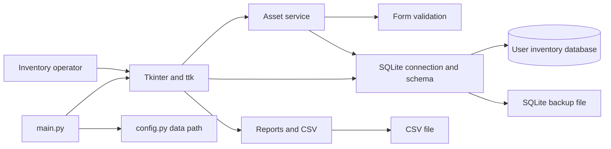
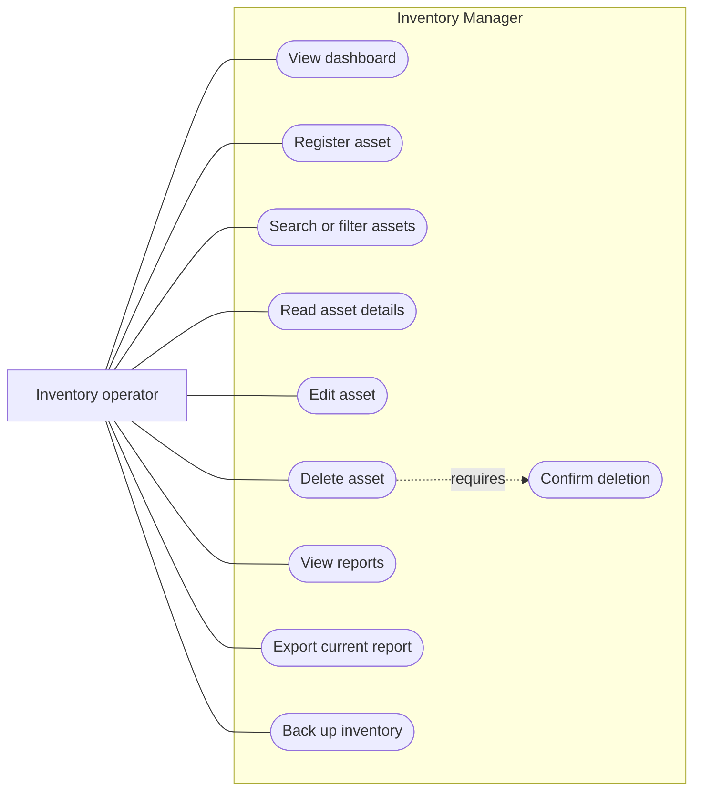
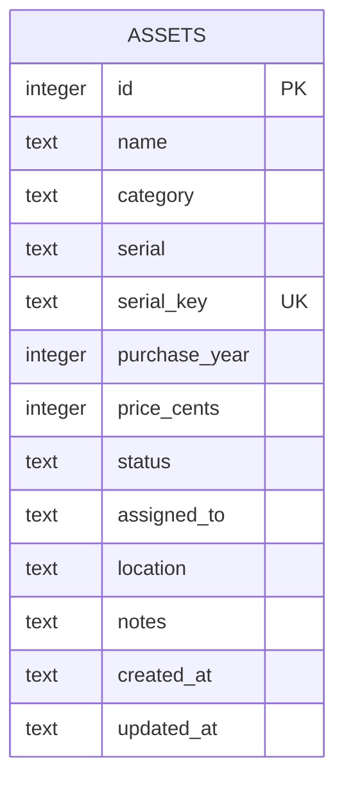
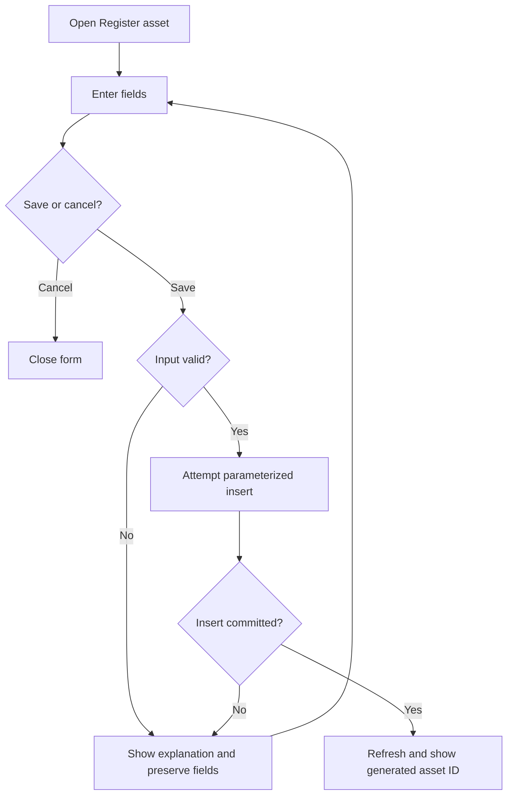
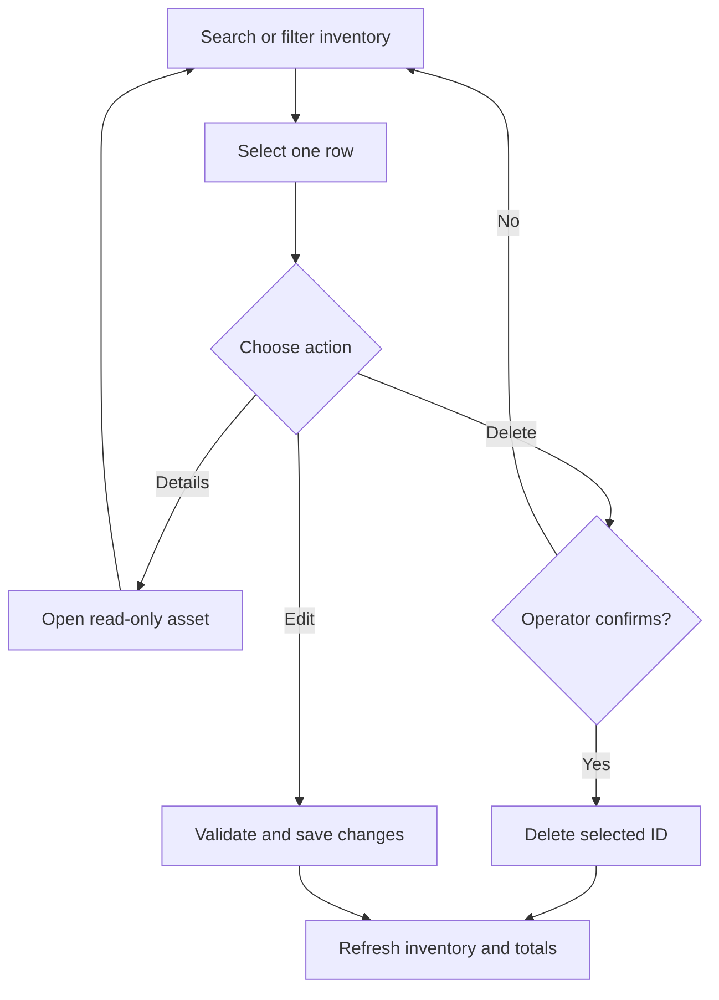
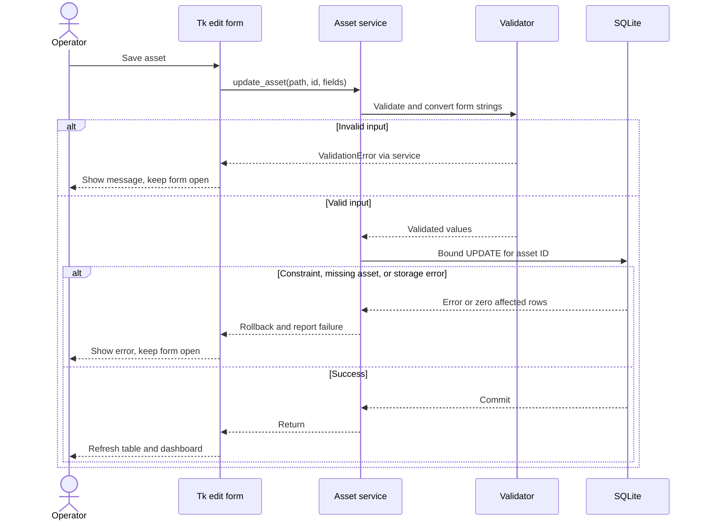
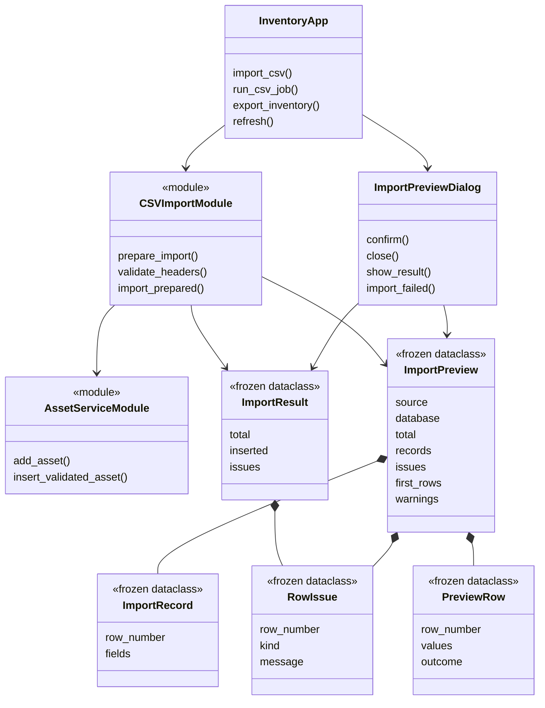
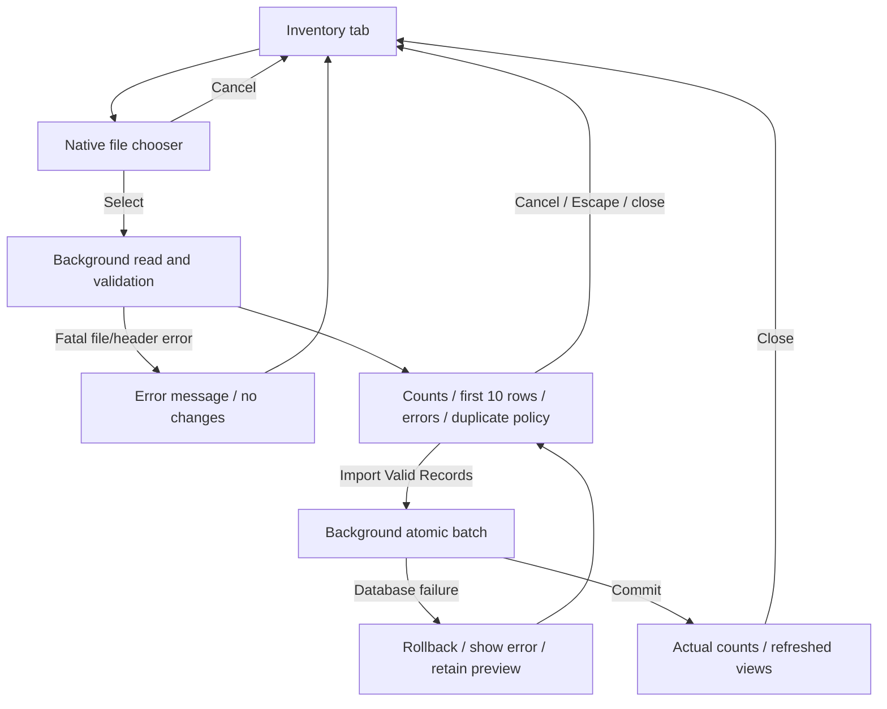

# Architecture and editable diagrams

Tk callbacks own interaction, selection and status messages. They send plain
form strings and asset IDs to the service. The service invokes validation,
binds values, and returns SQLite rows. Reports turn one inventory snapshot
into counts or tabular rows. No SQL is constructed from raw user input.

## Component architecture

## Use cases

## Entity relationship diagram

The system has one business entity. See the schema document for nullability,
money storage and internal SQLite metadata.

## Registration activity

## Asset management activity

## Sequence for saving an edit

## CSV feature: components and data flow (DFD level 1)

The enhancement adds no table or schema version. The report exporter remains;
`export_inventory` supplies the missing full-record interchange format.

```mermaid
flowchart LR
    Operator[Operator] -->|Select file| GUI[InventoryApp / native chooser]
    CSV[UTF-8 CSV] --> Parser[csv.reader / validate_headers]
    GUI -->|Worker prepares snapshot| Parser
    Parser --> Validator[Existing validate_asset]
    Validator --> Dedup[Serial duplicate detection]
    DB[(Existing assets table)] -->|Read-only serial keys| Dedup
    Dedup --> Preview[Immutable ImportPreview]
    Preview -->|Queue / main thread| Dialog[ImportPreviewDialog]
    Dialog -->|Explicit confirmation| Batch[import_prepared]
    Batch -->|Revalidate / recheck serials| Tx[BEGIN IMMEDIATE]
    Tx -->|Shared parameterized insert| DB
    Tx --> Result[Commit all or rollback all]
    Result -->|Queue / main thread| Views[Results and refreshed views]
```

This is the required pipeline: **CSV File -> CSV Parser -> Validation ->
Duplicate Detection -> SQLite Transaction -> GUI Refresh**. Preparation is
read-only. A transaction exists only after explicit confirmation. Worker results
cross `queue.Queue`; `root.after` polls on the Tk thread. SQLite connections are
created and closed in the thread doing the database work, never shared across
threads. Prior destroyed Tk widget cycles are finalized on the GUI thread before
launching a worker so worker allocations do not finalize old Tk variables.

## Class and module relationships for the final report

The application uses functions for services, rather than adding artificial
classes. The diagram distinguishes those modules from actual GUI/data classes.

## CSV screen flow

Zero-valid previews disable Import. There is no overwrite/update branch.
The final report's testing section should reference the CSV acceptance matrix
in TEST_PLAN.md, including both chooser/preview cancellation and induced
transaction failure, rather than treating successful parsing as full acceptance.
